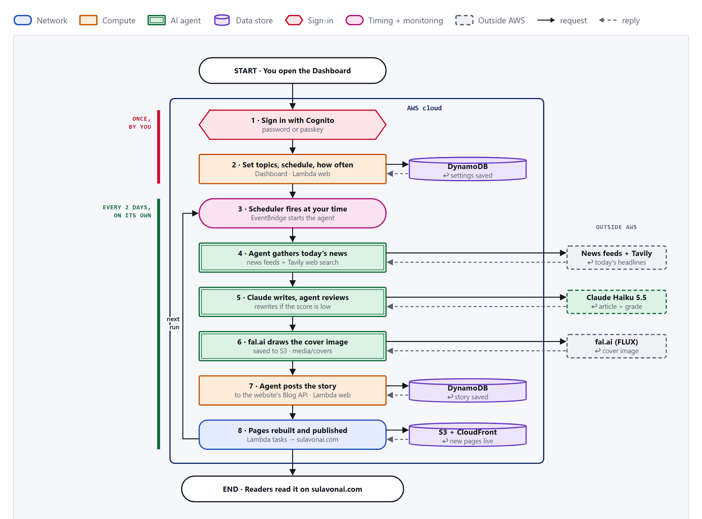

# Sulav on AI

**Live at [sulavonai.com](https://sulavonai.com)**

Sulav on AI is my personal site about AI and software delivery, and a working example of an agentic application in production. It has two parts:

- **An Agentic News Portal**: a news site researched, written, fact-checked, illustrated and published by AI agents, under topics and editorial rules I set.
- **Insights**: my own blog, written by me.

This repository is a public overview: what the system does and how it is put together at a high level. The source code is private.

---

## What the agent does

Every two days, without anyone pressing a button, an AI agent:

1. **Reads the news.** It scans technology news feeds and runs web searches across the topics I care about (AI-driven delivery, AI transformation, data privacy, rapid prototyping, productivity and AI progress), and skips anything on a "don't cover" list.
2. **Picks the strongest story.** It groups reports of the same event from different outlets, drops anything already covered, and ranks what is left by importance.
3. **Writes it.** Claude writes a sourced article with inline links to the original reporting.
4. **Checks it.** A second Claude pass grades the draft against its sources for accuracy, depth, clarity and engagement, and sends it back for rewrites if it falls short. Stories that still don't pass wait for a human instead of being published.
5. **Illustrates it.** An image model draws a cover that shows the topic as objects, never people.
6. **Publishes it.** The story goes live and the site's pages are rebuilt.

It is one agent with four jobs: the news story above, turning my notes into a full article, and keeping the Models and Tools pages up to date.

**Guardrails:** each paid service has a monthly budget the agent checks before spending, every run has a time limit, and nothing goes live that hasn't passed review.

---

## High-level architecture

You set things up once (sign in, choose topics and the schedule). From then on, steps 3 to 8 repeat on their own every two days. Only three things sit outside AWS: the news sources, Claude, and the image model.

| Layer | Built with |
| --- | --- |
| Public site | Pre-built pages on Amazon S3, served worldwide through Amazon CloudFront |
| Private dashboard and site API | AWS Lambda, behind Amazon Cognito sign-in (passkeys supported) |
| The agent | A LangGraph pipeline in a container on Amazon Bedrock AgentCore, running only while it works |
| Scheduling | Amazon EventBridge Scheduler |
| Data | Amazon DynamoDB; secrets in AWS Systems Manager Parameter Store |
| AI | Anthropic Claude (writing and reviewing), Tavily (web search), fal.ai FLUX (cover images) |
| Infrastructure | Terraform, deployed with a single guided script |

**Running cost:** a few dollars a month. The site is static, and the agent's container exists only for the minutes a run takes.

---

## About me

I lead the teams that turn business problems into software that changes how a company runs. More at [sulavonai.com](https://sulavonai.com) and on [LinkedIn](https://www.linkedin.com/in/sulav11/).
